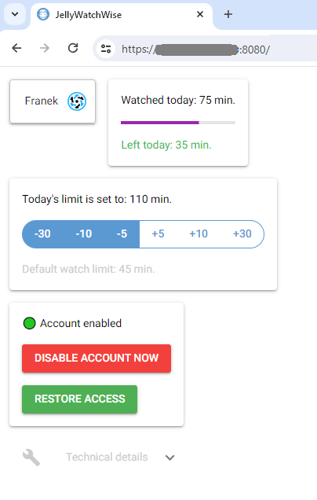

# JellyWatchWise <a href="https://www.buymeacoffee.com/jokerKP" target="_blank"></a>

JellyWatchWise is a Python application designed to help you manage and enforce watch time limits
for users accessing your Jellyfin media server. By integrating with the Jellyfin API, the app monitors
users' total watch time and restricts access to media libraries when their defined time limits are exceeded.

<table><tr><td valign="top">

## Features
* **Time limit for each user**

  Define separate time limits for each user to control their viewing habits.

* **Jellyfin integration**

  The app uses the Jellyfin API to monitor and manage user access.
* **GUI Management**

  Simple GUI for configuring time limits without additional logging in.

* **Requires Playback Reporting plugin or Jellystat server**

  Requires the 
  [`Playback Reporting`](https://github.com/jellyfin/jellyfin-plugin-playbackreporting) 
  plugin on your Jellyfin server
  or
  [`Jellystat`](https://github.com/CyferShepard/Jellystat)
  server to retrieve aggregated user playtime.

</td><td>



</td></tr></table>


##  Why a standalone app instead of a Jellyfin plugin?

This project focuses on simplicity and ease of use.
The standalone app includes a GUI for quick access to time limit settings,
allowing you to adjust values without logging into the Jellyfin server.

## How to use it?

### Prerequisites
1. Generate an **API Key** for JellyWatchWise from your Jellyfin admin account.
2. Ensure access to aggregated user statistics with either:
   * having the `Playback Reporting` plugin installed on your Jellyfin server 
      
     (this is default, no additional configuration needed),
     
   * access to your `Jellystat` server
    
     (put your host address and API key to the configuration file).

### Running with Docker
The easiest way to get started is by using Docker:

1. Pull the image

```bash
docker pull macjoker/jelly-watch-wise
```
2. Prepare configuration.

   Create a `config` folder with a `config.yaml` file.
   The file should include at least:
   * `host` - your Jellyfin server address
   * `token` - your Jellyfin API key.

   See [sample config file](https://github.com/Joker-KP/jelly-watch-wise/blob/main/config/config-sample.yaml) in the repository for reference.


3. Run the container

```bash
docker run -d -v ./config:/app/config -t macjoker/jelly-watch-wise
```
The app will also store logs and backups of media folder UUIDs in the specified config folder.

## How does the lock work?
The app polls the watch time of each user. When the time limit is exceeded, it applies a soft lock:
media currently playing continues until the end, but no new media can be started.
Once time is available again (limit raised or new day), the lock is removed.
The lock method is set with `limits.lock_method`.

**`folders` (default)**
unselects all media libraries for the user (except `no_limit_folders`).
Ensure Enable All Folders is not selected for any user you wish to have limits applied.
Instead, manually select individual media folders available to each user.
The selected folders are backed up in `config/user-folders.bck` and restored on unlock.

Note: while libraries are removed, Jellyfin answers requests for them with HTTP 401.
Some clients (e.g. Streamyfin 0.55 and later) treat any 401 as an expired session and log the user out.

**`tags`**
keeps all libraries and sets "Allow items with tags" (`AllowedTags`) to `no_limit_tag` (default `jww-no-limit`).
Only items carrying that tag stay visible, everything else is hidden: libraries stay visible,
and clients get (empty) lists with HTTP 200 instead of 401, so nobody gets logged out.
* Works with Enable All Folders too.
* The user's own allowed tags are backed up in `config/user-tags.bck` and restored on unlock.
* The lock state is read from the user policy, so restarting the app does not lose it.
* `no_limit_folders` is not supported. Instead, tag the media that should stay available with `no_limit_tag`
  (on a movie, an episode, or a series; episodes inherit the tag of their series).
  Tagging a whole library is not reliable: Jellyfin's list queries only check the item's and the series' tags.
* Switching from `folders` to `tags` restores libraries removed by an earlier `folders` lock.


**Immediate playback stop** is also possible.
The app includes buttons to immediately stop playback by disabling the user's account.
All connections of that user are then closed, and no logging in is possible until the account is enabled again.
